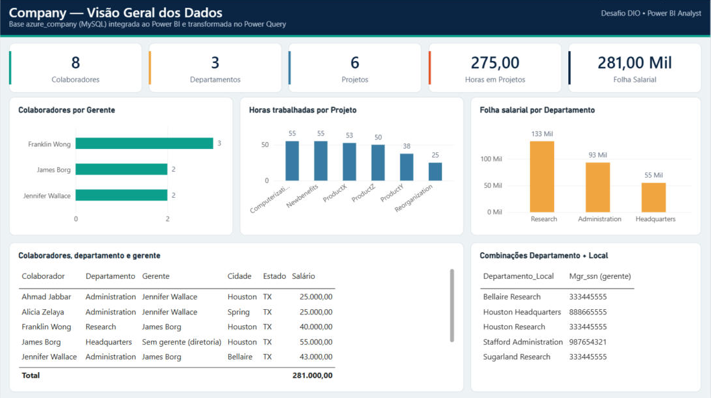
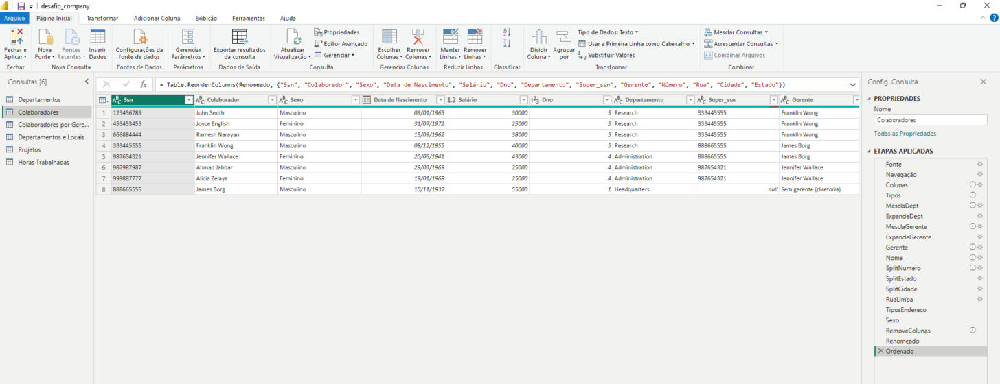
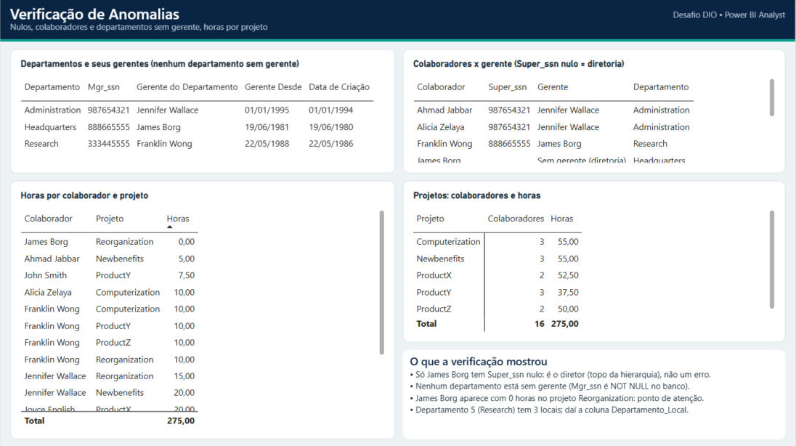

# 🗄️ Coleta e Processamento de Dados com Power BI — Desafio de Projeto DIO

Projeto da formação **Power BI Analyst** da [DIO](https://www.dio.me/) (Módulo 3). O objetivo é integrar um banco **MySQL** ao **Power BI**, verificar problemas na base de teste **Company** e aplicar as transformações pedidas no **Power Query**.



---

## 🗂️ Arquivos do repositório

| Arquivo / pasta | Descrição |
|---|---|
| `desafio_company.pbix` | Relatório do Power BI conectado ao MySQL, com todas as transformações |
| `sql/script_company_completo.sql` | Script único que cria o banco `azure_company`, popula as tabelas e traz a query colaborador x gerente |
| `power_query/consultas_power_query.m` | Código M (Power Query) de todas as consultas, comentado passo a passo |
| `imagens/` | Prints do relatório e do Power Query |

---

## 1. Banco de dados

O desafio pede uma instância MySQL na Azure. **Neste projeto o MySQL ficou local (MySQL Server 8.0, `localhost:3306`)**, com o mesmo schema `azure_company`. O processo de integração com o Power BI é igual. A única diferença é o endereço do servidor: na Azure seria algo como `meuservidor.mysql.database.azure.com`.

O banco foi criado com o script `sql/script_company_completo.sql`. Ele junta os dois scripts originais do curso (`script_bd_company.sql` e `insercao_de_dados_e_queries_sql.sql`) e corrige alguns pontos:

- os `INSERT`s apontavam para o schema `company_constraints`; agora tudo usa `azure_company`;
- o `drop table dependent` antes do `create` gerava erro e foi removido;
- as chaves estrangeiras já são criadas com `ON UPDATE` / `ON DELETE`, sem precisar de drop/add;
- a checagem de FK é desligada só durante os `INSERT`s, porque um colaborador referencia um gerente (`Super_ssn`) que ainda vai ser inserido;
- `IF NOT EXISTS` e `INSERT IGNORE` deixam o script seguro para rodar de novo.

| Tabela | Linhas |
|---|---:|
| employee | 8 |
| departament | 3 |
| dept_locations | 5 |
| project | 6 |
| works_on | 16 |
| dependent | 7 |

---

## 2. Integração MySQL ➜ Power BI

- Conector: **Obter dados → Banco de dados MySQL** (requer o *MySQL Connector/NET* instalado).
- Servidor `localhost`, banco `azure_company`, autenticação **Banco de Dados** (usuário e senha do MySQL).
- Cada consulta começa com:

```m
Fonte = MySQL.Database("localhost", "azure_company", [ReturnSingleDatabase = true])
```

> O conector do MySQL traz, além das colunas, colunas de relacionamento (`azure_company.employee`, `azure_company.project`…). Por isso, logo depois da navegação, cada consulta mantém só as colunas da própria tabela (`Table.SelectColumns`).

---

## 3. Transformações realizadas (Power Query)



| # | Pedido do desafio | O que foi feito |
|---|---|---|
| 1 | Verificar cabeçalhos e tipos de dados | Todas as colunas com tipo definido: textos, `Int64` para chaves numéricas, `date` para datas. |
| 2 | Valores monetários como *double* preciso | `Salary` convertido para **Número decimal** (`type number`) e renomeado para **Salário**. |
| 3 | Verificar nulos e analisar a remoção | O único nulo é `Super_ssn` de **James Borg**. Ele **não foi removido**: é o diretor, topo da hierarquia. |
| 4 | Colaboradores sem gerente | Só **James Borg** (`Super_ssn` nulo). Na coluna Gerente, ele aparece como *"Sem gerente (diretoria)"*. |
| 5 | Departamento sem gerente | **Nenhum.** `Mgr_ssn` é `NOT NULL` no banco e os 3 departamentos têm gerente. Mesmo assim, a consulta Departamentos tem um passo que preencheria uma lacuna com o gerente da sede (Headquarters), caso aparecesse. |
| 6 | Verificar o número de horas dos projetos | Consulta **Projetos** soma as horas de `works_on` por projeto (total: **275 h**). Foi encontrado um registro com **0 horas** (James Borg em *Reorganization*), destacado na página de verificações. |
| 7 | Separar colunas complexas | `Address` (ex.: `731-Fondren-Houston-TX`) virou **Número, Rua, Cidade e Estado**. A divisão usa o primeiro e os dois últimos `-`, então endereços como `975-Fire-Oak-Humble-TX` ficam certos (Rua = *Fire Oak*). |
| 8 | Mesclar `employee` e `departament` | Mescla com **junção externa esquerda** (base = employee), trazendo o **nome do departamento** de cada colaborador. A externa esquerda garante que nenhum colaborador some, mesmo que algum fique sem departamento. Colunas desnecessárias foram removidas. |
| 9 | Juntar colaboradores e nomes dos gerentes | Feito no Power BI com uma **mescla da tabela employee com ela mesma** (`Super_ssn` ➜ `Ssn`, externa esquerda). A query SQL equivalente está abaixo. |
| 10 | Mesclar Nome e Sobrenome | `Fname` + `Lname` viraram a coluna **Colaborador**. `Minit` foi removida. |
| 11 | Mesclar nomes de departamentos e localização | Na consulta **Departamentos e Locais**: `Dlocation` + `Departamento` ➜ **Departamento_Local** (ex.: *Houston Research*, *Stafford Administration*). Cada combinação departamento-local fica única, o que ajuda no modelo estrela futuro. |
| 12 | Agrupar colaboradores por gerente | Consulta **Colaboradores por Gerente**: Franklin Wong (3), Jennifer Wallace (2), James Borg (2). |
| 13 | Eliminar colunas desnecessárias | Removidas `Minit`, `Address` original, colunas auxiliares das mesclas e as colunas de relacionamento do conector MySQL. A tabela `dependent` não foi carregada, porque não é usada no relatório. |

### Query SQL: colaborador x gerente

```sql
SELECT CONCAT(e.Fname, ' ', e.Lname) AS Colaborador,
       CONCAT(g.Fname, ' ', g.Lname) AS Gerente
FROM employee e
LEFT JOIN employee g ON e.Super_ssn = g.Ssn;
```

### Por que usar **mesclar** e não **atribuir (acrescentar)** na junção departamento + local?

**Acrescentar consultas** empilha as linhas de uma tabela embaixo da outra (como um `UNION`). Ele serve para tabelas com a **mesma estrutura**, e o resultado tem mais linhas, sem relacionar nada.

Aqui o objetivo é outro. Precisamos **colocar lado a lado** informações de tabelas diferentes que se relacionam pela chave `Dnumber`: o nome do departamento vem de `departament` e o local vem de `dept_locations`. Depois, juntamos os dois valores em uma coluna só (`Departamento_Local`). Isso exige combinar colunas de registros relacionados, que é o que a **mescla** faz (como um `JOIN`), seguida de **mesclar colunas**. Acrescentar não cruza as informações de departamento com as de local, então não daria a combinação única.

---

## 4. Relatório

O relatório tem duas páginas, feitas para **verificar as informações e possíveis anomalias**:

**Visão Geral**
- Cartões: 8 colaboradores, 3 departamentos, 6 projetos, 275 horas em projetos e folha salarial de 281 mil
- Colaboradores por gerente
- Horas trabalhadas por projeto
- Folha salarial por departamento
- Tabela de colaboradores com departamento, gerente e endereço separado
- Combinações Departamento + Local

**Verificações**



- Departamentos e seus gerentes (confirma que nenhum está sem gerente)
- Colaboradores x gerente (mostra o `Super_ssn` nulo da diretoria)
- Horas por colaborador e projeto, ordenadas da menor para a maior (destaca o registro de 0 horas)
- Projetos com número de colaboradores e total de horas

---

## ▶️ Como reproduzir

1. Rode `sql/script_company_completo.sql` no MySQL (Workbench ou linha de comando).
2. Instale o [MySQL Connector/NET](https://dev.mysql.com/downloads/connector/net/).
3. Abra `desafio_company.pbix` no Power BI Desktop. Se o servidor for diferente de `localhost`, ajuste em **Transformar dados → Configurações da fonte de dados**.
4. Informe usuário e senha do MySQL e clique em **Atualizar**.

---

## 🧰 Tecnologias

- MySQL 8.0 + MySQL Workbench
- Power BI Desktop + Power Query (linguagem M)

---

Feito por **Felipe** como parte da formação Power BI Analyst da [DIO](https://www.dio.me/). 🚀
